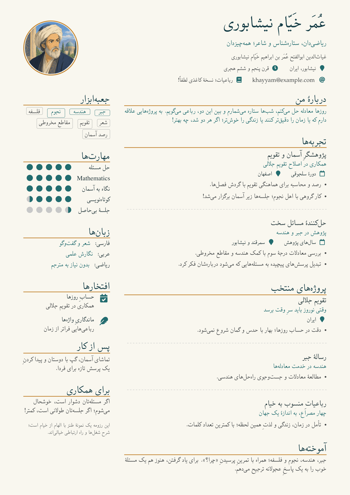

# XePersian CV Template

A Persian résumé template with right-to-left typography, a two-column layout, and a warm ivory, teal, and gold palette. Built with **XeLaTeX**, **XePersian**, and a customized **AltaCV** class.

<p dir="rtl" align="right">قالب رزومهٔ فارسی با چیدمان راست‌به‌چپ، طراحی دو ستونه و امکان شخصی‌سازی رنگ‌ها و قلم‌ها.</p>

The example imagines a résumé for **Omar Khayyam**: mathematician, astronomer, and poet. Its playful descriptions and contact details are fictional—replace them with your own story.

## Preview

[](main.pdf)

[View the sample PDF](main.pdf) · [Explore the LaTeX source](main.tex)

## Features

- **Persian typography:** UTF-8 text and right-to-left layout through XePersian.
- **Two columns:** main content on the right, with skills, languages, and highlights on the left.
- **Light and dark palettes:** switch themes with a document class option.
- **Reusable components:** section headings, experience entries, skill ratings, tags, languages, and achievements.
- **Personal details:** a circular portrait, icons, and clickable contact links.
- **Bundled Persian fonts:** XB Yas font files are included in `fonts/`.
- **A4 output:** the sample fits on one page; the columns can continue onto additional pages as your CV grows.

## Get started

### Build locally

Use a LaTeX installation with **XeLaTeX**, such as TeX Live or MiKTeX. The template uses packages including `xepersian`, `paracol`, `fontawesome5`, `fontspec`, `tikz`, and `tcolorbox`; a full TeX installation is the easiest starting point.

Download or clone this repository, open a terminal in its root directory, and run:

```sh
xelatex -interaction=nonstopmode -halt-on-error main.tex
xelatex -interaction=nonstopmode -halt-on-error main.tex
```

Open `main.pdf` to see the result. Run the commands again after editing the source.

**Use XeLaTeX:** this template's `rtl` option requires it. In your LaTeX editor, select XeLaTeX as the compiler.

### Use on Overleaf

1. Download this repository as a ZIP and upload it as a new project.
2. Select **XeLaTeX** as the compiler and **`main.tex`** as the main document.
3. Keep `altacv.cls`, `khayyam.png`, and the `fonts/` directory in the project, then compile.

## Make it yours

Most changes belong in [`main.tex`](main.tex); you can keep the class file as it is.

| What to change | Where to edit |
| --- | --- |
| Name and professional title | `\name{...}` and `\tagline{...}` |
| Contact information | The `\personalinfo{...}` block |
| Portrait | Replace `khayyam.png` and update `\photoL{3.3cm}{khayyam}` if you rename it |
| Sections and experience | `\cvsection{...}` and `\cvevent{title}{organization}{dates}{location}` |
| Skills and tags | `\cvskill{label}{rating}` (0–5, including halves) and `\cvtags{...}` |
| Colors | The `\definecolor` entries near the top of the file |
| Margins and column widths | `\geometry{...}` and `\columnratio{0.30}` |
| PDF title and author | The `\hypersetup{...}` metadata |

### Dark palette

Add `darkmode` to the document class options:

```tex
\documentclass[11pt,a4paper,ragged2e,withhyper,rtl,darkmode]{altacv}
```

### Persian and Latin text

Write Persian directly in UTF-8. Wrap inline English, URLs, and Latin numbers in `\cvlatin{...}` when they need left-to-right direction:

```tex
\cvsection{پروژه‌ها}
توسعهٔ ابزارهای علمی با \cvlatin{Python}.
```

The template loads **XB Yas** from `fonts/` and uses **TeX Gyre Pagella** for Latin text. If the bundled regular font is absent, it looks for Amiri, Noto Naskh Arabic, then Tahoma on your system.

Keep `\usepackage{xepersian}` **after all other package imports** so its bidirectional typesetting support can configure them correctly.

## Project files

| File | Purpose |
| --- | --- |
| [`main.tex`](main.tex) | Sample CV, content, colors, and font settings |
| [`altacv.cls`](altacv.cls) | Customized AltaCV class with RTL support and CV components |
| [`main.pdf`](main.pdf) | Compiled sample résumé |
| [`assets/preview.png`](assets/preview.png) | PDF image displayed in this README |
| [`khayyam.png`](khayyam.png) | Sample portrait |
| [`fonts/`](fonts/) | XB Yas font files |

The bibliography files (`sample.bib` and `pubs-*.cfg`) are inherited examples; the current CV does not use a bibliography.

To refresh the README image after rebuilding the PDF, use Poppler's `pdftoppm`:

```sh
pdftoppm -f 1 -singlefile -scale-to 1600 -png main.pdf assets/preview
```

## Credits

Based on [AltaCV by LianTze Lim](https://github.com/liantze/AltaCV), with subsequent fork work credited to Nicolás Omar González Passerino in the class header. This edition adds Persian/Arabic RTL support and the Khayyam-inspired design.

The distribution and modification terms for `altacv.cls` are recorded in its header: **LaTeX Project Public License, version 1.3 or later**.
